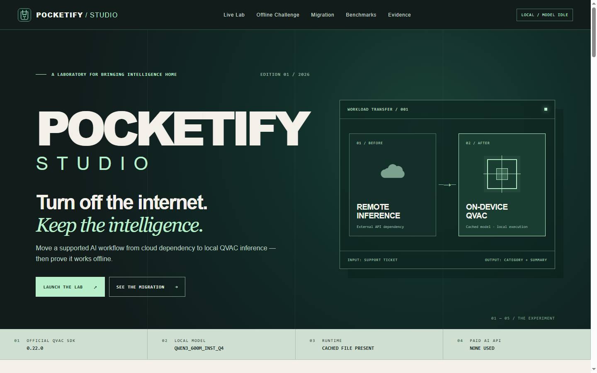
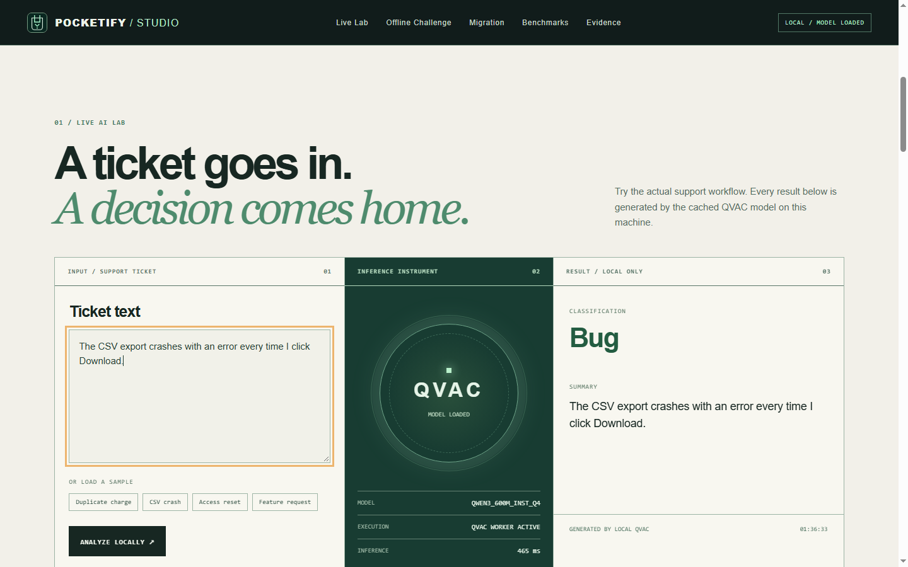

# POCKETIFY / STUDIO

**Turn off the internet. Keep the intelligence.**

Move a supported AI workflow from cloud dependency to local QVAC inference — then prove it works offline. Pocketify Studio is a local developer instrument for real ticket triage, a conservative offline challenge, a controlled migration demo, and evidence-backed benchmarks. Built for **AI Yako: Own Your AI / Cloud to Pocket**.





## Launch Studio

From Windows PowerShell in this repository:

```powershell
.\scripts\start-studio.ps1
```

Open **http://127.0.0.1:4317**. The launcher installs project-local packages only if missing, creates local QVAC config if needed, builds static evidence data, and starts the loopback-only server. Cache the model once while connected with `node .\qvac-gate.mjs`; the launcher does not download model weights automatically. If PowerShell blocks local scripts, use `powershell.exe -NoProfile -ExecutionPolicy Bypass -File .\scripts\start-studio.ps1`. `npm.cmd run studio` starts the server directly after setup.

The same `site/` files form a **Render Static Site** after deployment. The public page lets visitors inspect recorded QVAC ticket outputs and measured evaluations; it cannot run QVAC or claim live inference. No public Render URL is claimed until the deployed site has been verified.

## Render Static Site

The root [render.yaml](render.yaml) describes the deployment. In Render, choose **New → Static Site**, connect `chapaevv123/pocketify-qvac`, select `main`, leave Root Directory blank, set Build Command to `node scripts/build-showcase.mjs`, and Publish Directory to `site`. Set the build environment variable `SKIP_INSTALL_DEPS=true`. Then click **Create Static Site**. No paid instance, API key, model download or QVAC package installation is needed on Render. Render builds only the static showcase from committed evaluation data. No SPA fallback or web server is required.

The local Windows Studio remains the only surface that performs new QVAC inference and the Offline Challenge. The public site links to its launch instructions and labels every sample output as a **recorded** local result with its source run and expected category. The owner-run disconnected inference is reported, but a complete public offline PASS receipt and video are pending. Cloud baseline remains **NOT MEASURED**.

### Five-minute judge path

1. Click **Explore the Demo**, select a sample ticket, and click **Analyze Locally** in Local Studio. The output, model ID and measured inference time come from the official QVAC SDK. On Render, selecting a sample shows only its labeled recorded result.
2. Click **Start Offline Challenge** while connected to load the cached model. Manually disconnect Wi-Fi in Windows or unplug Ethernet, leaving `localhost` open. Check the manual-disconnect box, then click **Verify & Infer**. Studio checks local reachability, DNS, TCP, HTTPS and ICMP before/after real inference and generates a downloadable JSON receipt. Reconnect manually afterward.
3. Click **See the Migration**, run the scanner, apply the supported config migration, inspect the generated backup and changed config, then reset the dedicated demo workspace.
4. Inspect the actual ten-ticket evaluation, outcome matrix, per-ticket latency, run variability and explicit **CLOUD BASELINE NOT MEASURED** label. Use **Run Fresh Evaluation** for a new real run.

The prior owner-run physical offline inference is reported, but its saved log lacks a simultaneous network record. The new challenge requires all tested external routes to fail before and after inference; its receipt is evidence of those checks, not cryptographic proof of total isolation. In the Codex sandbox, ICMP reached `1.1.1.1` during a genuine challenge run, so Studio correctly recorded `FAIL`. A final physically disconnected receipt and video remain owner actions.

Studio uses `127.0.0.1`, fixed routes, an 8 KiB request cap, same-origin POST checks, a dedicated ignored migration workspace, and no arbitrary shell or filesystem API. The local QVAC backend and original CLI are shared; there is no second inference engine. See [architecture](docs/ARCHITECTURE.md) and [security](docs/SECURITY.md).

## Pocketify CLI — move a ticket AI workflow from cloud to your device

**Cloud to Pocket track · AI Yako: Own Your AI**

Pocketify finds a supported OpenAI compatible JavaScript integration, changes the bundled Ticket Triage example to use the official QVAC SDK, then measures local classification accuracy and latency on an independently labeled dataset. Its core inference works from cached model weights without an internet connection. No paid API is used.

## Evidence at a glance

On Windows 10 Pro, RTX 3070, Node 22.23.1, `@qvac/sdk` 0.22.0 and `@qvac/cli` 0.17.0, QVAC Doctor passed. The official catalog model `QWEN3_600M_INST_Q4` (Unsloth Qwen3-0.6B Q4_0 GGUF, 382,156,480 bytes) generated real output. The first ten-ticket local evaluation scored **8/10 (80%)**, with **150 ms median** inference latency. The latest run scored **6/10 (60%)**, with **161.5 ms median** latency and **6,006 ms** model load. The first generation in each run took about 7 seconds and reflects warm-up. This small model's predictions vary between runs; see the committed sample reports in `reports/`. Rerun `node pocketify.mjs eval` for fresh results. Cloud quality and speed are **NOT MEASURED**.

The owner-run offline log shows the cached model loaded and produced output, but no adapter or connectivity log was saved with it. An early Codex evaluation passed a TCP-only probe, but a later ping to the same public IP succeeded; that early run is **not** proof of full disconnection. The current offline workflow rejects reachable TCP or ICMP and should be recorded after manually disconnecting the machine.

## Quickstart (Windows PowerShell)

```powershell
Set-Location C:\path\to\pocketify-qvac
.\scripts\setup.ps1
$env:QVAC_CONFIG_PATH = (Resolve-Path .\qvac.config.json).Path
node .\qvac-gate.mjs          # once online, downloads and validates the model
node .\pocketify.mjs scan .\examples\ticket-triage
node .\pocketify.mjs migrate .\examples\ticket-triage
node .\pocketify.mjs triage 'The CSV export crashes when I click Download.'
node .\pocketify.mjs eval
Start-Process .\reports\latest.html
```

`setup.ps1` skips installation when QVAC is already present. A fresh clone uses `npm.cmd ci` locally. Model weights are downloaded by QVAC and remain outside Git. If PowerShell script execution is restricted, run `powershell.exe -NoProfile -ExecutionPolicy Bypass -File .\scripts\setup.ps1`; this affects that process only.
The script creates a machine-local `qvac.config.json` from `qvac.config.template.json`, with an absolute cache path inside the project.

## Offline judge demo

1. Complete the online quickstart once and confirm the model appears in `.qvac/models`.
2. Disconnect internet manually using the Windows UI. Do not disable the adapter by script.
3. Run `.\scripts\demo-offline.cmd` in the project directory. It checks outbound TCP and ICMP, scans, migrates, classifies a ticket, evaluates ten labeled tickets, and opens `reports/latest.html`.
4. Capture the adapter state and the report in the demo video. Restore connectivity manually afterward.

The script refuses to call the run offline if either probe succeeds. Failed probes alone remain limited evidence; show the actual Windows disconnected state as well. The cached SDK model is checked and used locally. No cloud AI endpoint is called by this workflow.

## CLI

| Command | Action |
| --- | --- |
| `node pocketify.mjs scan [directory]` | List supported JS/TS integration patterns and locations. |
| `node pocketify.mjs migrate [directory]` | Back up and switch the bundled example config to QVAC; safe to rerun. |
| `node pocketify.mjs triage "ticket"` | Run real local QVAC classification and summary. |
| `node pocketify.mjs eval [--offline]` | Evaluate ten independent labels and write JSON and HTML reports. |
| `npm.cmd test` | Pure unit tests. |
| `npm.cmd run test:integration` | Test with the real cached QVAC model. |
| `npm.cmd run test:studio` | Studio API, challenge verdict and migration safety tests. |
| `npm.cmd run test:studio:integration` | Real QVAC inference and challenge receipt via Studio API. |
| `npm.cmd run build:showcase` | Rebuild public static data from committed evaluation evidence. |

The supported migration contract is a JS/TS repository with `new OpenAICompatClient(config)` and a root `pocketify.json` matching the bundled example. The scanner also identifies common `openai` imports, constructors, chat completions, and Responses API calls **for review only**. Pocketify does not rewrite arbitrary source files or promise automatic migration of unrelated repositories. It writes a backup before changing the supported config and rejects unknown configurations.
The example includes a cloud HTTPS transport for the original workflow, but it is disabled unless a user explicitly sets `POCKETIFY_ALLOW_CLOUD=1` and provides `OPENAI_API_KEY`. No such call was made for this project. The hackathon demo uses the migrated QVAC path and needs no key or paid service.

## How QVAC is used

`src/qvac-client.mjs` imports `loadModel`, `completion`, `unloadModel`, and `QWEN3_600M_INST_Q4` from `@qvac/sdk`. It adapts the request and response to the familiar `client.chat.completions.create(...)` shape. `src/triage.mjs` uses a constrained JSON schema to ask the QVAC model for category and summary. The model executes locally via QVAC's Bare worker and llama.cpp plugin. `kvCache: false` avoids a QVAC profile cache dependency in restricted environments. `qvac.config.json` pins the project model cache and also exposes an optional QVAC OpenAI-compatible server configuration. The MVP app uses the direct SDK path; no other inference engine is substituted.

## Evaluation and privacy

`data/golden-tickets.json` defines ten synthetic tickets with expected categories before inference. `src/evaluation.mjs` records every prediction, summary, latency, model identity, SDK version, host free RAM snapshots, client RSS, and outbound probe result. Host free RAM is system-wide and client RSS excludes the worker, so neither is reported as exact QVAC memory consumption. The report marks cloud performance **NOT MEASURED**. Ticket content is handled in the local process and QVAC worker; use synthetic data for demos.

## Requirements, licenses, limits

- Windows 10+ x64 with Vulkan >=1.4 even for CPU inference; Node >=22.17 and npm >=10.9. This machine uses Windows 10 Pro, RTX 3070 with Vulkan 1.4.351, and 32 GB RAM. See [QVAC requirements](https://docs.qvac.tether.io/sdk/system-requirements/).
- QVAC packages are project local: `@qvac/sdk` 0.22.0 and `@qvac/cli` 0.17.0, both Apache-2.0 according to their installed package metadata. See [official JS/TS SDK](https://docs.qvac.tether.io/sdk/js-ts-sdk/).
- Model: [Unsloth Qwen3-0.6B-GGUF](https://huggingface.co/unsloth/Qwen3-0.6B-GGUF), Apache-2.0. Exact catalog SHA-256 is recorded in the report. The model is not redistributed in this repository.
- QVAC's OpenAI-compatible HTTP server is documented [here](https://docs.qvac.tether.io/cli/http-server/). In this Codex sandbox, its `/v1/chat/completions` route returned 500 because QVAC attempted to write a KV cache under the protected user profile. The direct SDK workflow succeeds with KV cache disabled. Normal PowerShell may permit the server, but that route is not required for this MVP.
- A 0.6B model can misclassify tickets and produce imperfect summaries. Runs of the release prompt scored 8/10 and 6/10, including 6/10 in the latest run. A deterministic decoding trial scored 6/10 and a longer-prompt trial scored 5/10. The latter two are exploratory and are preserved in local evidence, not represented as release metrics. No cloud comparison is claimed.
- Setup and model download require connectivity. Offline inference needs cached weights and installed dependencies. A failed TCP probe is supporting evidence, not a complete network audit.

See [architecture](docs/ARCHITECTURE.md), [security and limitations](docs/SECURITY.md), [measured evidence](docs/EVIDENCE.md), and [submission materials](docs/SUBMISSION.md). Work created for this event: scanner, migration, Ticket Triage app, dataset, evaluator, report, tests, and docs. QVAC and model weights are third-party dependencies credited above.

## Publishing the Studio update

The existing repository is [chapaevv123/pocketify-qvac](https://github.com/chapaevv123/pocketify-qvac). Review and publish this Render update from ordinary PowerShell if `gh auth status` is valid. Render deploys new commits to `main` after the static site has been created.

```powershell
Set-Location C:\Users\Win10_Game_OS\Projects\Pocketify
gh auth status
# If authentication is invalid: gh auth login -h github.com
git -c safe.directory=C:/Users/Win10_Game_OS/Projects/Pocketify status --short
git -c safe.directory=C:/Users/Win10_Game_OS/Projects/Pocketify add -A -- render.yaml README.md docs site .github scripts/verify-showcase.mjs
git -c safe.directory=C:/Users/Win10_Game_OS/Projects/Pocketify diff --cached --check
git -c safe.directory=C:/Users/Win10_Game_OS/Projects/Pocketify commit -m "Deploy Pocketify Studio showcase on Render"
git -c safe.directory=C:/Users/Win10_Game_OS/Projects/Pocketify push origin main
```

Confirm with `git -c safe.directory=C:/Users/Win10_Game_OS/Projects/Pocketify ls-files` that `.qvac/`, `node_modules/`, `evidence/`, `.env`, and model weights are absent. The per-command `safe.directory` override changes no global Git configuration. Do not submit the DoraHacks Build until the owner reviews the public site, captures a playable offline demo video, and approves submission.
