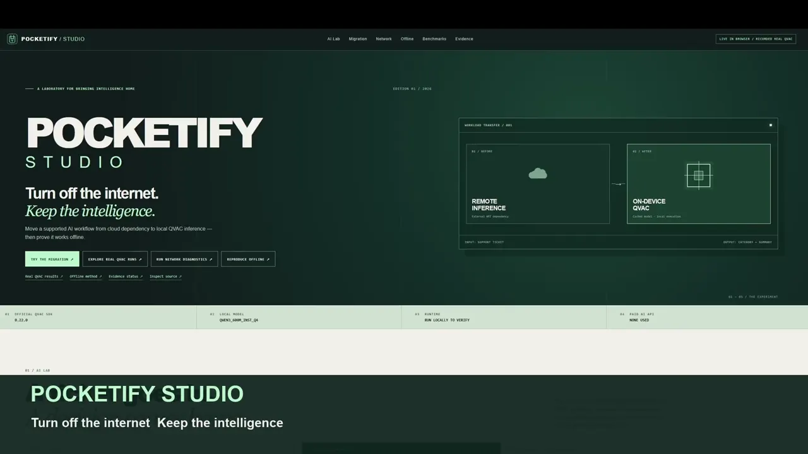
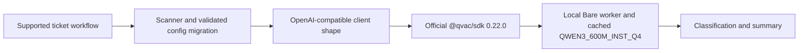

# Pocketify Studio

**Turn off the internet. Keep the intelligence.** Pocketify scans a supported OpenAI-compatible ticket workflow, migrates its configuration safely, and runs fresh local inference through the official QVAC SDK. Its public site offers a real browser scanner and migration lab, recorded QVAC evidence, and browser network observations. Public playback is never presented as live model inference.

[](https://pocketify-qvac.onrender.com/#watch)

**[Watch the 101-second film](https://pocketify-qvac.onrender.com/#watch)** · **[Try the public lab](https://pocketify-qvac.onrender.com/)** · **[Offline instructions](https://pocketify-qvac.onrender.com/offline.html)** · **[Evidence and receipts](https://pocketify-qvac.onrender.com/evidence.html)**

## What judges can try

| Surface | What actually runs |
| --- | --- |
| Public Render Static Site | Scanner over bundled source, supported configuration migration in memory with backup/diff/reset, recorded QVAC results, same-origin browser network checks |
| Local Studio at `127.0.0.1:4317` | Fresh QVAC inference, model warm-up, selected external probes, offline challenge and JSON receipt |

The migration edits only a validated `pocketify.json` in the local demo workspace or a browser memory copy. It does not rewrite arbitrary applications. The public site needs no model download or paid API.

## Reproduce locally on Windows

Use Node.js 22+ and a regular PowerShell window. Run the gate once while online to cache the official model:

```powershell
git clone https://github.com/chapaevv123/pocketify-qvac.git
Set-Location .\pocketify-qvac
powershell.exe -NoProfile -ExecutionPolicy Bypass -File .\scripts\setup.ps1
node .\qvac-gate.mjs
powershell.exe -NoProfile -ExecutionPolicy Bypass -File .\scripts\start-studio.ps1
```

Open **http://127.0.0.1:4317**. Click **Start Offline Challenge** while connected: the Studio checks the cache, samples external routes and runs genuine warm-up inference. Then disconnect Wi-Fi or Ethernet manually in Windows, keep localhost open, check the acknowledgement, and click **Verify & Infer**. Download the JSON receipt and restore connectivity manually. [Full field guide](docs/OFFLINE_AUDIT.md).

No administrator rights, firewall changes or adapter scripts are required. A PASS would mean the defined selected routes were reachable before and blocked during fresh inference; it cannot prove every possible network path was isolated.

## Architecture



`src/qvac-client.mjs` imports `loadModel`, `completion` and `unloadModel` from the official SDK. The cached runtime model ID is `bc5c55956168a616`. Browser-only static QVAC inference is not supported by the installed SDK's Node/Bare worker path. Model weights and private config stay outside Git and Render.

## Measured results

The ten-ticket synthetic evaluation has fixed ground truth. Original-prompt runs scored **8/10, 6/10, 6/10** with median inference **150, 158, 161.5 ms**. A generic prompt clarification scored **6/10 and 5/10** with medians **152.5 and 138 ms**, so it was reverted. All five full JSON runs remain available on the [evidence page](https://pocketify-qvac.onrender.com/evidence.html) and in `reports/`. First inference includes model warm-up; these medians do not measure page latency. A cloud baseline was **not measured**.

Two historical challenge receipts show real QVAC inference while selected external checks failed, but their verdict is **INCONCLUSIVE**. DNS returned `UNAVAILABLE / ECONNREFUSED`, no reachable external route was observed before disconnection, and the supplied recording does not show Windows adapter state. The [offline audit](docs/OFFLINE_AUDIT.md) explains the exact decision.

## Verify and inspect

```powershell
npm.cmd test
npm.cmd run test:studio
npm.cmd run test:integration
npm.cmd run test:studio:integration
npm.cmd run build:showcase
```

The interactive static site is built by `node scripts/build-showcase.mjs` and published from `site/` on Render. The edited 101-second video is reproducible with `node scripts/montage-demo.mjs` when FFmpeg and the original private recordings are available; [source timestamps](site/media/source-manifest.json) are public. Raw recordings are ignored by Git. The final captioned MP4 is 5.8 MB and is published as a static asset for direct playback.

More detail: [evidence](docs/EVIDENCE.md), [offline verification](docs/OFFLINE_AUDIT.md), [architecture](docs/ARCHITECTURE.md), [security](docs/SECURITY.md), [submission text](docs/SUBMISSION.md), [video notes](docs/VIDEO_DEMO.md).

Known limitations: the 0.6B model misclassifies some tickets; the public page cannot run the QVAC worker; selected probe failures do not prove physical disconnection; no cloud comparison was measured. These limits are shown in the product and source data.

MIT licensed. QVAC SDK, QVAC CLI and model weights are third-party components with their own licenses; they are not bundled into the static site.
