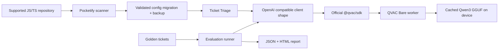

# Architecture

The bundled example starts with a cloud-oriented `pocketify.json`. Its OpenAI-compatible HTTPS transport is deliberately disabled unless the owner explicitly opts in and supplies a key; no cloud request was made for this project. The scanner identifies integration points in JS/TS source. Migration validates the supported config, creates `pocketify.json.cloud.backup`, and atomically replaces the config with `provider: qvac-sdk`. It never edits source code. The same `chat.completions.create` call then uses QVAC.

`OpenAICompatClient` retains `chat.completions.create` semantics. Its QVAC adapter loads the official catalog model, calls `completion` with `responseFormat` JSON schema and `kvCache: false`, then maps the response back to the familiar choice/message structure. One model stays loaded through an evaluation run; each CLI triage invocation loads and unloads it. The evaluation process writes `reports/latest.json` and `reports/latest.html`.

The scanner recognizes common OpenAI SDK syntax for review, but migration is limited to the config contract above. This scope is intentional: changing arbitrary call sites or prompt semantics without tests would be unsafe. The JSON report records raw outcomes to make quality claims auditable.
