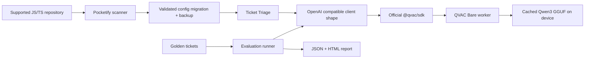
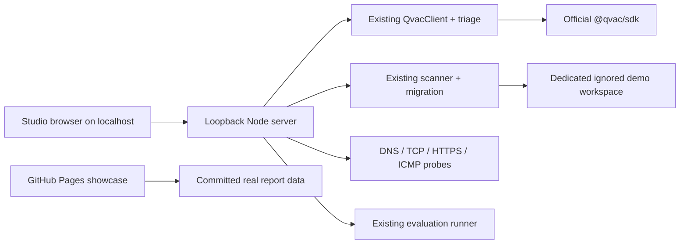

# Architecture

The bundled example starts with a cloud-oriented `pocketify.json`. Its OpenAI-compatible HTTPS transport is deliberately disabled unless the owner explicitly opts in and supplies a key; no cloud request was made for this project. The scanner identifies integration points in JS/TS source. Migration validates the supported config, creates `pocketify.json.cloud.backup`, and atomically replaces the config with `provider: qvac-sdk`. It never edits source code. The same `chat.completions.create` call then uses QVAC.

`OpenAICompatClient` retains `chat.completions.create` semantics. Its QVAC adapter loads the official catalog model, calls `completion` with `responseFormat` JSON schema and `kvCache: false`, then maps the response back to the familiar choice/message structure. One model stays loaded through an evaluation run; each CLI triage invocation loads and unloads it. The evaluation process writes `reports/latest.json` and `reports/latest.html`.

The scanner recognizes common OpenAI SDK syntax for review, but migration is limited to the config contract above. This scope is intentional: changing arbitrary call sites or prompt semantics without tests would be unsafe. The JSON report records raw outcomes to make quality claims auditable.

## Pocketify Studio surfaces

`site/` is one framework-free HTML/CSS/JavaScript interface. `studio/server.mjs` serves those same files on `127.0.0.1:4317` and exposes fixed JSON endpoints. GitHub Pages publishes `site/` as a static showcase using `scripts/build-showcase.mjs`, which transforms committed evaluation JSON and real source text into `site/data.json`. On GitHub Pages the UI disables all live actions and says local inference requires Studio. There is no simulated QVAC response.

The Live Lab calls `POST /api/triage`; the server holds one QVAC model instance for repeated requests. The Offline Challenge first calls `/api/prepare` while connected, then the owner disconnects manually. `/api/challenge/verify` records external probes; `/api/challenge/infer` runs genuine triage, probes again, and writes a JSON receipt under ignored `.studio/receipts/`. A PASS requires the owner's disconnection confirmation, a reachable local server, successful inference, and all external checks blocked both before and after. Any reachable route makes FAIL. Probe errors that cannot determine reachability make UNVERIFIED. This is a bounded connectivity test, not proof of every possible route.

Migration routes use only `examples/studio-workspace/`, seeded from the real example source and a cloud-oriented config. The scanner and migration implementation are the existing CLI modules. The migration creates `pocketify.json.cloud.backup`; the reset action restores the seed config in that dedicated workspace. No browser-provided filesystem paths are accepted. Benchmarks are read from committed sample reports plus an optional ignored latest run; a fresh evaluation calls the existing evaluator.
